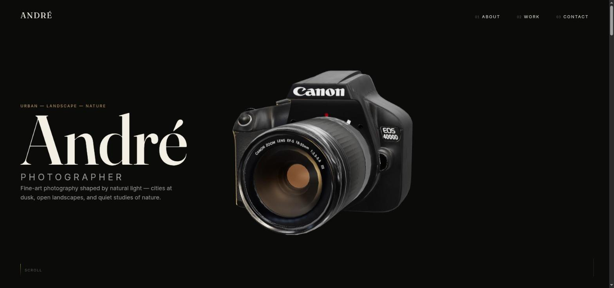

# André — Portfolio



🔗 **Demo:** [ruanparreira.github.io/andre-photographer-showcase](https://ruanparreira.github.io/andre-photographer-showcase/)

Site pessoal em página única (single-page) para o portfólio de fotografia do André. Seções com scroll-animations em GSAP e uma câmera 3D (Three.js) renderizada no Hero em dispositivos com boa capacidade de hardware.

Este projeto é uma reconstrução de um site de portfólio mais antigo, feito quando eu estava aprendendo Tailwind CSS. A versão anterior continua disponível no GitHub como referência de evolução: [RuanParreira/PortfolioAndre](https://github.com/RuanParreira/PortfolioAndre).

## Stack

- **React 19 + Vite** — SPA, sem roteamento (single page)
- **GSAP** (`useGSAP`, `ScrollTrigger`, `ScrollSmoother`, `SplitText`, `Flip`, `Observer`) — animações de scroll e transições
- **Three.js** — modelo 3D de câmera no Hero, carregado sob demanda
- **CSS Modules** — sem framework de utilitários global
- **sharp** — pipeline de otimização de imagens responsivas

## Rodando o projeto

```bash
npm install
npm run dev       # servidor de desenvolvimento (Vite)
npm run build     # build de produção
npm run preview   # preview do build de produção
npm run lint       # eslint
```

Não há suite de testes configurada.

## Estrutura

```
src/
  lib/gsap.js        # setup centralizado do GSAP e plugins (sempre importar daqui)
  lib/images.js       # descoberta de imagens via import.meta.glob
  three/               # CameraCanvas + CameraScene (modelo 3D, lazy-loaded e gated)
  sections/
    Hero/              # apresentação + câmera 3D
    About/             # sobre
    Work/              # galeria de trabalhos, filtros por categoria (Flip) + Lightbox
    Contact/            # contato
  data/work.js         # fonte única de verdade do conteúdo do portfólio
scripts/
  optimize-images.mjs  # gera imagens responsivas (WebP + fallback JPEG) a partir de imgs/
public/models/camera.glb
```

## Adicionando um trabalho novo

1. Colocar a foto original em `imgs/Projetos`.
2. Adicionar o arquivo ao mapa `WORK_SLUGS` em `scripts/optimize-images.mjs`.
3. Rodar `node scripts/optimize-images.mjs` para gerar os tamanhos responsivos em `src/assets/work/`.
4. Adicionar uma entrada correspondente em `src/data/work.js` (slug, título, localização, ano, categoria, tamanho no grid).

## Acessibilidade

Todas as animações respeitam `prefers-reduced-motion`: quando ativo, o `ScrollSmoother` é desativado e cada seção pula sua animação via a prop `reducedMotion`. O modelo 3D também não é carregado nesse caso (nem em telas pequenas / sem ponteiro fino).

## Créditos

Modelo 3D "Camera CANON EOS 400D" por [santy](https://sketchfab.com/Santy), via [Sketchfab](https://sketchfab.com/3d-models/camera-canon-eos-400d-c8c3f307e93f4c829d579d1b369e6b02), licenciado sob [CC-BY-4.0](http://creativecommons.org/licenses/by/4.0/). Crédito também exibido na seção de Contato/rodapé do site.
